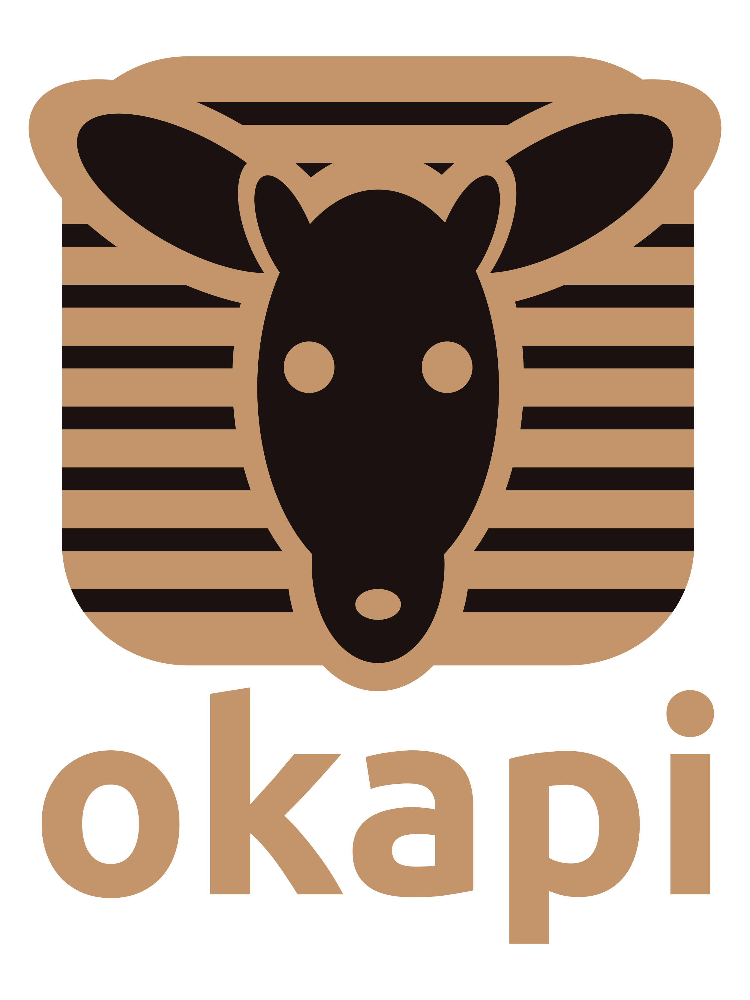
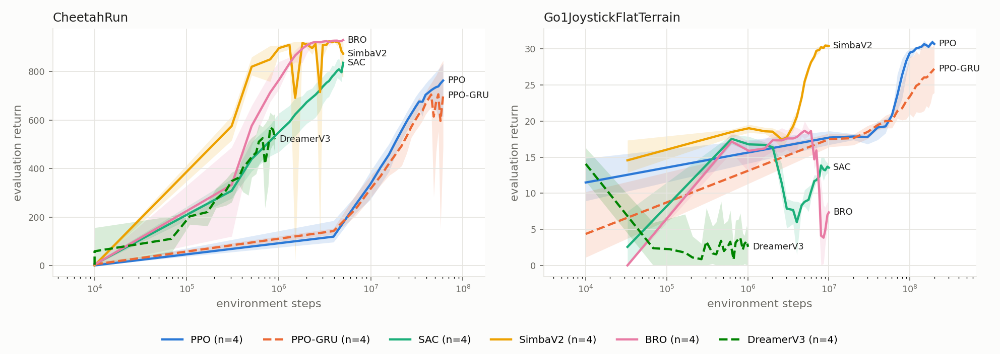
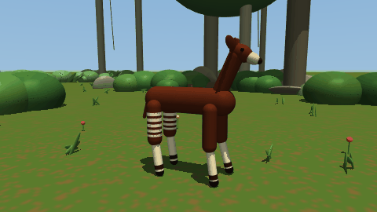
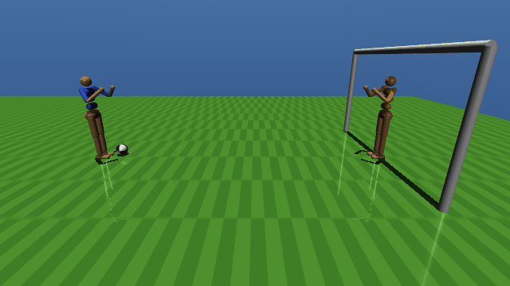
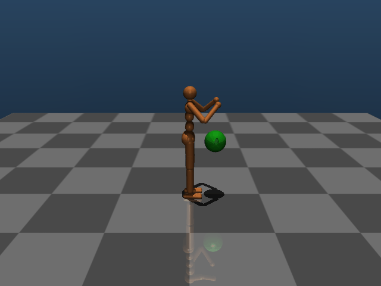
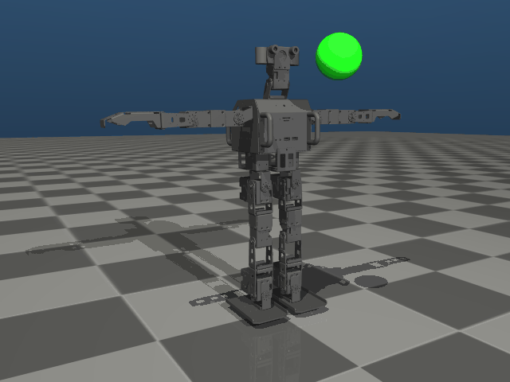
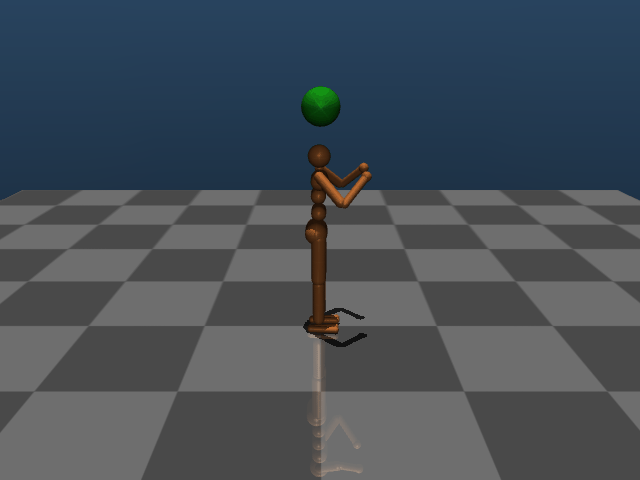

# okapi: Deep RL with JAX, Flax NNX and MuJoCo Playground
<a></a>

Single-file implementations of deep reinforcement learning algorithms in JAX and
[Flax NNX](https://flax.readthedocs.io/en/latest/nnx_basics.html) for
[MuJoCo Playground](https://playground.mujoco.org/). Physics
([MJX](https://mujoco.readthedocs.io/en/stable/mjx.html) or
[MuJoCo Warp](https://mujoco.readthedocs.io/en/stable/mjwarp/index.html)), inference,
replay and gradient updates all run on the GPU.

📖 **Documentation:** [okapi.readthedocs.io](https://okapi.readthedocs.io)

| Algorithm | File | Paper |
|---|---|---|
| PPO | [`ppo.py`](src/okapi/ppo.py) | [Schulman et al., 2017](https://arxiv.org/abs/1707.06347) |
| PPO-GRU | [`ppo_gru.py`](src/okapi/ppo_gru.py) | PPO with recurrent actor and critic |
| SAC | [`sac.py`](src/okapi/sac.py) | [Haarnoja et al., 2018](https://arxiv.org/abs/1812.05905) |
| SimbaV2 | [`simbav2.py`](src/okapi/simbav2.py) | [Lee et al., 2025](https://arxiv.org/abs/2502.15280) |
| BRO | [`bro.py`](src/okapi/bro.py) | [Nauman et al., 2024](https://arxiv.org/abs/2405.16158) |
| DreamerV3 | [`dreamerv3.py`](src/okapi/dreamerv3.py) | [Hafner et al., 2023](https://arxiv.org/abs/2301.04104) |
| TD-MPC2 | [`tdmpc2.py`](src/okapi/tdmpc2.py) | [Hansen et al., 2024](https://arxiv.org/abs/2310.16828) |

Every algorithm has the same interface (`Config`, `train(...) -> Policy`,
`load_policy(run_dir)`) and the same option names. Shared plumbing (environments, replay
buffer, logging, checkpoints, evaluation) lives in [`okapi/common`](src/okapi/common).

## Getting started

```bash
git clone https://github.com/alexanderdittrich/okapi.git && cd okapi
uv sync
uv run scripts/train.py algo=sac env_id=CheetahRun
```

The same from Python: every algorithm module has a config class and a `train` function.

```python
from okapi.sac import SACConfig, train

cfg = SACConfig(env_id="CheetahRun", total_timesteps=2_000_000)
policy = train(cfg)
```

The returned policy maps environment observations to actions:

```python
import jax
from mujoco_playground import registry

env = registry.load("CheetahRun")
state = env.reset(jax.random.key(0))
action, _ = policy(state.obs)
state = env.step(state, action)
```

Look at a trained policy (each run lives in `runs/`; train with `checkpoint=true`):

```bash
uv run scripts/view.py runs/<run_dir>                     # interactive viewer
uv run scripts/render.py runs/<run_dir> --output out.mp4  # video
```

## Benchmarks

Four seeds per algorithm on an RTX 4080 Super. See the
[benchmark page](https://okapi.readthedocs.io/en/latest/benchmarks.html) for settings and
throughput.



| Algorithm | CheetahRun | Go1 joystick | Throughput (Cheetah) |
|---|---|---|---|
| PPO | 763 ± 87 (60M) | 30.7 ± 0.1 (200M) | 662k steps/s |
| PPO-GRU | 701 ± 144 (60M) | 27.2 ± 3.3 (200M) | 298k steps/s |
| SAC | 836 ± 20 (5M) | 13.5 ± 0.6 (10M) | 53k steps/s |
| SimbaV2 | 874 ± 59 (5M) | **30.4 ± 0.2** (10M) | 6.1k steps/s |
| BRO | **930 ± 2** (5M) | 7.3 ± 0.8 (10M) | 11k steps/s |
| DreamerV3 | 537 ± 57 (1M) | 2.6 ± 1.5 (1M) | 0.6k steps/s |

## Showcase tasks

Football-inspired tasks adapted from [goncalog/ai-robotics](https://github.com/goncalog/ai-robotics)
and a quadruped okapi, in [`examples/`](examples).

### Okapi locomotion


### Penalty shoot-out: striker vs. keeper


### Foot tricks with a humanoid


### Foot tricks with the OP3 robot


### Head tricks with a humanoid


## Notes

okapi is a compact research and hobby codebase, not a heavily validated framework.
For production use, consider [Brax](https://github.com/google/brax),
[CleanRL](https://github.com/vwxyzjn/cleanrl), [RSL-RL](https://github.com/leggedrobotics/rsl_rl)
or [stable-baselines3](https://github.com/DLR-RM/stable-baselines3). okapi vectorizes with
`vmap` on a single GPU. Issues and PRs are welcome.

PPO is adapted from [Brax](https://github.com/google/brax) (Apache 2.0). The checkpoint
viewer is adapted from [rscope](https://github.com/Andrew-Luo1/rscope) (MIT).
